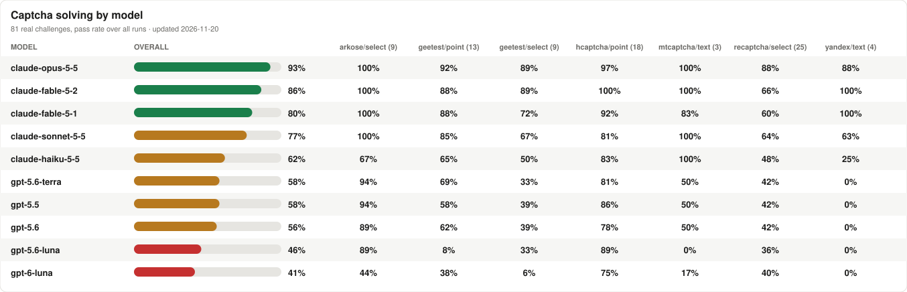

# LLM Captcha Solver

[](BENCHMARK.md)

Solves verification challenges (reCAPTCHA v2, hCaptcha, Cloudflare Turnstile, Tencent TCaptcha, Aliyun captcha and nocaptcha sliders, GNAME, DataDome and phishing-kit "slide to verify" sliders, text captchas, and anything you describe with an adapter) with a vision model of your choice, for AI agents that drive a browser.

It is built to be run and improved by agents. Unsolved challenges are reported as GitHub issues with replayable fixtures, fixes are proven against those fixtures, and installations update themselves. **Agents: start with [AGENTS.md](AGENTS.md).**

It ships as two things that share one engine:

- **A Chrome extension** that works on its own. Any agent driving the browser (Grok, Claude, browser-use, a script) benefits without integration.
- **A CDP library** for Playwright/patchright, Puppeteer or a raw CDP connection: `solveCaptchas(host)`.

## How the agent knows what is going on

The top document publishes the state:

```html
<html data-captcha-state="solving|solved|failed" data-captcha-detail="recaptcha-images"></html>
```

A `captcha-state` event fires on `window` with every change. One line in the agent's prompt is enough: _"If `<html data-captcha-state>` is `solving`, wait until it is `solved` or `failed` before acting."_

## Architecture

```
src/core/       runtime-agnostic: engine (solve loop), adapters, prompt, model call (AI SDK),
                gesture plans, CDP input, scoring
src/page/       runs inside page frames (isolated world): scanner, canvas image tools
                (crop, label, motion), state publishing
src/extension/  MV3 extension: content script (scanner + frame offsets + wake-up),
                ExtensionDriver (chrome.scripting + chrome.debugger), options page
src/cdp/        CdpDriver over any CDP session provider; Playwright and Puppeteer hosts
src/tools/      developer and operations tools (`bun run <name>`): explore, capture, eval,
                bench (benchmark/), pull-reports, update, and what they share
fixtures/       real challenges by provider (recaptcha/, hcaptcha/, tencent/), replayed by eval and bench
test/           unit, e2e (local pages + vendor test widgets, every driver), live (real widgets)
```

The engine talks to a browser only through `Driver` (`src/core/driver.ts`): `scan`, `reveal`, `input` (trusted mouse and keys, screenshots), `images` and `publish`.

- **ExtensionDriver.** Content scripts in every frame scan, and resolve frame offsets by asking their parent frame. `chrome.debugger` is attached only while a challenge is being solved, for trusted input.
- **CdpDriver.** The page bundle (`dist/page.js`) is injected into an isolated world per frame, which page scripts cannot see. Out-of-process frames are found through `iframe` targets. Closed shadow roots (Turnstile) are read with `DOM.getDocument({pierce})` and handed to the scanner.

Each solve round:

1. Scan every frame for challenges and pick the open popup over its checkbox.
2. Scroll it into view.
3. Capture a burst of frames (for animated challenges) and find the regions that moved.
4. Label targets on the image and ask the model for actions.
5. Run the actions as human-like CDP gestures (eased approach, minimum-jerk drags, focus emulation).
6. Read the widget's verdict and feed errors into the next round.

Checkboxes are clicked without a model, spaced so the vendor's verdict can arrive (Turnstile restarts its check on every click).

The model is asked only about a challenge at rest. These checks cost no round:

- **Loading or animating:** the scanner reports a challenge as `waiting` while an image in it is still loading or a finite CSS animation or transition is running, such as reCAPTCHA's replacement tiles fading in.
- **Still changing on screen:** each round's frames are compared; any change in a non-animated challenge, or a change across most of an animated one, means it has not settled.
- **Moved while the model thought:** the challenge is scanned again just before acting, and the answer is dropped if the challenge moved meanwhile.

Animated challenges (`point` by default, or `animated: true` in the adapter) are captured as 3 frames 300 ms apart. hCaptcha fades its shapes in and out, so a single frame hides some of them. The model gets every frame, with the moving regions outlined and listed.

## Recovering by itself

When a challenge goes wrong, the engine responds in steps:

- **Wrong answer:** the widget's error goes back to the model with the earlier rounds.
- **Two rejections in a row:** the engine asks the widget for a new puzzle (its reload button) and starts with a fresh history.
- **Failed model call:** the next configured fallback model takes over.
- **Lost wake-up:** a frame that stays pending wakes the service worker again every few seconds, which covers a restarted service worker or a run that was just ending.
- **Stalled call:** every wait, screenshot and model call ends at the session deadline.
- **Failed session:** the page reads `failed` with a reason. The extension does not retry that tab (no paid loops) until it navigates.

## Improving itself

1. **Failure reports.** With reports configured (options page, or `reportToGitHub` in the library), a failed session pushes its last rounds as fixtures and the challenge frame's markup to a `fixtures/<provider>/<time>` branch. It then files a `challenge-failure` issue showing what the model saw, or comments on the open one with the same title. Page URLs are reported without query or fragment.
2. **Triage.** `bun run pull-reports` restores reported rounds into `fixtures/captured/`. You or an agent label them, reproduce with `bun run eval`, fix the root cause, and open a PR that carries the new fixtures.
3. **Self-update.** `bun run update --install` checks hourly. It accepts only fast-forwards of a clean checkout, builds into a staging directory and swaps it in only when the unit tests pass, so a broken commit never reaches `dist/`. The extension notices the new `build.json` and reloads itself between solves.

    Updates run code from the upstream branch in your browser: point the checkout at a repository you trust.

## Model

Pick any provider through the AI SDK: OpenAI-compatible (xAI, Ollama, OpenRouter, …), OpenAI, Anthropic or Google. Set the endpoint, key and model in the options page. The key stays in `chrome.storage.local`.

**No model configured: assist mode.** The extension then puts each challenge to whoever drives the browser. A panel on the page, placed away from the challenge, shows the labeled screenshot, the instruction and the answer syntax, with a labeled input. Screenshot, DOM and accessibility-tree agents can all read and use it, and so can a person; `data-captcha-detail` says an answer is needed. The answer syntax:

- `t2 t5 verify` clicks targets;
- `120,80` clicks a point of the image;
- `drag 10,20 200,20` drags between two points;
- `type XK4P9` types (for text challenges the bare characters work too).

The extension turns the answer into precise trusted clicks, reports errors back, and handles the readiness waits and retries as with a model. Agents that decline CAPTCHAs by policy will decline this too.

To choose one, see the **[leaderboard](BENCHMARK.md)**, also published on the project's GitHub Pages. It shows each model's pass rate per challenge type (provider × kind) on the labeled real-world fixtures, replayed exactly as the solver asks live.

`bun run bench` updates it incrementally. It re-measures only (model, fixture) pairs whose fixture or solver code changed, so adding a fixture or a model costs a few calls. Provider outages are retried later instead of counted.

Models come from `benchmarks/models.json`:

- explicit entries, with keys from the environment (`${ANTHROPIC_API_KEY}`, …);
- a `discover` entry, which adds every model an OpenAI-compatible gateway lists (`${GATEWAY_URL}/models`).

A model the gateway refuses for good (for example no image input) is recorded as unsupported and not tried again. A local `benchmarks/models.local.json` overrides the list.

The weekly CI workflow checks the gateway for models that were never measured and stops right there if there are none. Otherwise it benchmarks just the new ones, commits the leaderboard and this chart, and deploys the page to GitHub Pages. For a prompt or engine change, run `bun run bench` locally and commit the result with the change.

## Adapters

A challenge is described declaratively. These selectors are what the scanner uses:

```json
{
	"id": "my-grid",
	"kind": "select",
	"url": "widgets\\.example\\.com/challenge",
	"root": "#challenge",
	"instruction": [".prompt"],
	"errors": [".error"],
	"solved": ".success",
	"targets": [
		{ "id": "t", "selector": ".tile", "all": true, "selected": ".is-selected" },
		{ "id": "verify", "selector": "button.verify", "labelFromText": true }
	]
}
```

The `kind` field takes one of four values:

- `checkbox`: click it, no model.
- `select`: pick targets.
- `text`: read and type.
- `point`: click or drag positions; captured as 3 frames by default, to see animations.
- `slider`: drag the `handle`; no model involved. It has two modes:
  - **Puzzle**: until the `piece` image fits the gap in the `background` image (Tencent TCaptcha, AliyunCaptcha puzzle). The gap is found by image analysis, since the drop must land within a few pixels. Dark and light gaps both work, and an ambiguous gap gets a new puzzle (`reload`) instead of a guess.
  - **Slide to end**: without a piece, the handle goes past the end of its `rail` (Aliyun nocaptcha and slide, GNAME, DataDome simple, kit gates) on a human track that never goes back.

  A refused slider that shows only a `reload` ("error, click to refresh") gets it clicked.

Custom adapters go in the options page; the built-ins are in `src/core/adapters.ts`.

## Development

```sh
bun install
bun run build        # dist/page.js, dist/extension/, dist/cdp/
bun run typecheck
bun run test         # unit tests
bun run e2e          # local challenge pages and real vendor test widgets × {extension, Playwright, Puppeteer}, mock model
bun run check        # all of the above
bun run live         # real widgets over the network (third parties: not part of check)
bun run explore --vendor recaptcha   # every frame's element tree, HTML and a screenshot → out/explore/
bun run explore <url> --fill "input[name=email]=a@example.com" --click "a.get_code"
```

`explore` is where a new adapter starts. Its vendor recipes (`src/tools/vendor-pages.ts`) bring up each real challenge:

- the reCAPTCHA and hCaptcha demos, and Turnstile forced interactive;
- Tencent under its own domain (vendors bind site keys to domains, so our page is served at a URL of that domain);
- Aliyun's `nc` slider with the public test appkey of Aliyun's demos;
- the forms that guard GNAME's and Eranet's sliders (filled with a black-hole address).

`capture --vendor <name>` and the live tests use the same recipes. The live suite currently solves the real Tencent puzzle (valid ticket), Aliyun's `nc` slider (Aliyun's server passes the first slide), and GNAME's and Eranet's form sliders (accepted and closed).

The e2e tests run headful local Chrome. Branded Chrome ignores `--load-extension`, so the harness loads the extension through CDP `Extensions.loadUnpacked`.

### Fixtures: replayable real challenges

The model's accuracy is what matters most, so real challenges are kept as fixtures:

```sh
bun run capture --vendor recaptcha --sessions 3      # or any URL
#   → fixtures/captured/<provider>/<time>-<adapter>-r<round>/
#     fixture.json, frame-N.png, labeled.png
```

Each captured round holds the view, the frames, what the model saw, its decision and the errors the widget showed afterwards. To label one, look at the frames, write `expected` and `notes` into `fixture.json`, and move the directory to `fixtures/<provider>/<name>/` (for example `fixtures/recaptcha/dynamic-bus-1/`). The provider is the first segment of the adapter id. Fixtures you are unsure about keep `"expected": null` and a note; eval skips them. The `expected` field is one of these forms:

- `{"clicks": ["t2", "t5", "verify"]}`
- `{"text": "XK4P9"}`
- `{"points": [{"x": 120, "y": 80, "r": 30}], "clicks": ["submit"]}` (CSS px relative to the region)

Two more fixture kinds need no model:

- **Slide puzzles** (`fixtures/tencent/`): `background.png`, `piece.png`, and a `fixture.json` with `kind: "slider"`, the piece's `origin` and the `expected` gap `offset`, in background pixels. `eval` checks them.
- **Page fixtures** (`fixtures/generic/`): `page.html`, a real challenge page saved as captured (links to elsewhere rewritten to local stand-ins), and a `fixture.json` with `kind: "page"` and the `expected` outcome (`state`, `navigatesTo`). The e2e suite serves them and solves them under every driver.

```sh
bun run eval                       # replay all labeled fixtures through the model, score them
bun run eval --filter recaptcha/ --runs 3    # filter by "<provider>/<name>" substring
bun run bench                                # every model in benchmarks/models.json → BENCHMARK.md
```

The live model for capture and eval is set by `LLM_PROVIDER`, `LLM_BASE_URL`, `LLM_API_KEY` and `LLM_MODEL`.
