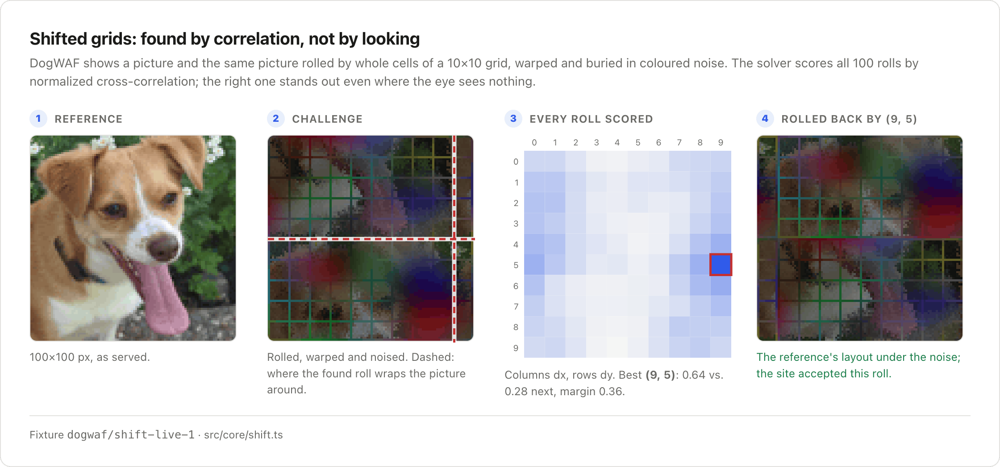
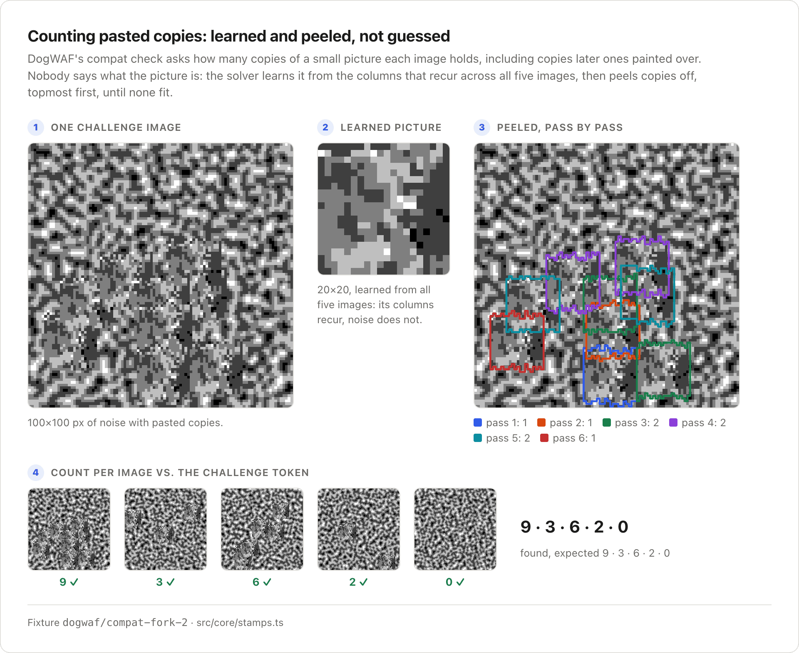

# Adapters

An adapter tells the scanner what a challenge looks like: where it is, what it asks, what can be clicked and how it reports success or failure. The built-ins are in [`src/core/adapters/`](../src/core/adapters/), one file per provider; your own go in the extension's options page (or `adapters` in the library) and are checked first.

```json
{
	"id": "my-grid",
	"kind": "select",
	"url": "widgets\\.example\\.com/challenge",
	"root": "#challenge",
	"instruction": [".prompt"],
	"errors": [".error"],
	"solved": ".success",
	"targets": [
		{ "id": "t", "selector": ".tile", "all": true, "selected": ".is-selected" },
		{ "id": "verify", "selector": "button.verify", "labelFromText": true }
	]
}
```

`bun run explore <url>` saves every frame's element tree (closed shadow roots included), its HTML and a screenshot to `out/explore/`: that is where a new adapter starts.

## Fields

| Field | Meaning |
|---|---|
| `id` | unique; its first segment is the provider (`recaptcha-images` → `recaptcha`) |
| `kind` | how the challenge is solved, see [kinds](#kinds) |
| `url` | regex the frame URL must match |
| `root` | the first visible match is the challenge; its box is the region the model sees |
| `instruction` | selectors whose visible text is the task |
| `errors`, `errorsHidden`, `errorsMatch` | failed-attempt text: visible, screen-reader only, and a regex for status elements that also announce success |
| `solved`, `solvedText` | selector, or regex over visible texts, that means passed |
| `response` | the token field next to the widget's frame; solved only once it holds a value |
| `blocked`, `blockedText` | a refusal ("try again later"): the session fails at once |
| `waiting` | busy (a spinner): nothing to do now |
| `targets` | `{ id, selector, all?, optional?, selected?, labelFromText? }`; with `all`, ids are numbered (`t1`, `t2`…) |
| `pierce` | search inside open and closed shadow roots |
| `retryMs` | least time between two checkbox clicks (default 5000) |
| `animated` | capture 3 frames and show the model what moved (default for `point`) |

## Kinds

| Kind | Solved by | Example |
|---|---|---|
| `checkbox` | a click, no model; without targets, waiting for a check that runs by itself, or failing on a refusal | Turnstile, Anubis |
| `select` | the model picks targets | reCAPTCHA images |
| `point` | the model clicks or drags positions | hCaptcha, GeeTest icons |
| `text` | the model reads and types; several inputs (`input1`, `input2`…) each take their own answer | Yandex, MTCaptcha |
| `slider` | image analysis and a drag, no model | Tencent, Aliyun |
| `hold` | a press held until the widget is done | HUMAN Press & Hold |

### `slider`

Drags the `handle`, in one of two modes:

- **Puzzle**, with `piece` and `background` targets: the gap is found by image analysis, since the drop must land within a few pixels. The images may be ``, `<canvas>` or CSS backgrounds and are measured as shown. Dark and light gaps both work. The drag starts with a short nudge, reads where the piece went, and corrects the rest, so pieces that lag their handle land too. An ambiguous gap, or the same puzzle after a failed slide, gets a new puzzle (`reload`) instead of a guess. Images that only show under the pointer (float mode) are revealed by hovering the handle.
- **Slide to end**, with a `rail`: the handle goes past the end of the rail on a human track that never goes back.

A refused slider that shows only a `reload` ("error, click to refresh") gets it clicked.

### `hold`

Presses the `handle` and keeps holding, with slight pointer movement, until the widget is done. It waits for the widget to arm first and retries when its progress never starts.

## Extra declarations

### `carousel` (on `select`)

```json
"carousel": { "options": "pip", "next": "right", "submit": "submit" }
```

Arkose's "use the arrows" games show one option at a time (`pip1`…`pipN` mark the current one; `right` shows the next). The engine pages through all of them, shows the model one contact sheet with the options labeled `o1`…`oN`, goes to its pick and submits.

### `shiftedGrid` (on `point`)

```json
"shiftedGrid": 10
```

DogWAF shows a clean reference image (the root) and a `challenge` target: the same picture rolled by whole squares of a 10 × 10 grid and noised. The model points into the reference. Every roll is scored by correlating the two images, and the matching challenge square is clicked, scrolled into view first if needed. An unclear roll gets a new challenge (`refresh`) instead of a guess.



### `stamps` (on `text`)

```json
"stamps": { "size": 20, "wobble": 4 }
```

DogWAF's compat page shows `image` targets with copies of one small picture pasted over noise, each column moved down by up to `wobble - 1` pixels, and an `input` per image for how many. No model needed:

1. **Learn the picture.** Its columns recur exactly wherever a copy shows them, while noise columns almost never do, and column *j + 1* recurs right of column *j*. The best-supported chain of recurring columns is the picture.
2. **Count by peeling.** The copy pasted last is fully visible. Every placement that fits the picture exactly is a copy; once found, its pixels become wildcards, which uncovers the copies under it for the next pass.

When the picture cannot be learned (DogWAF itself drops half of each copy's pixels), the model counts instead.


