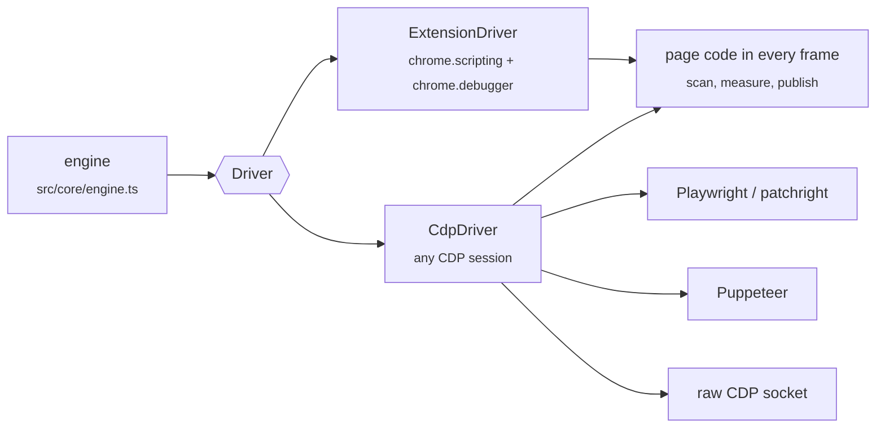
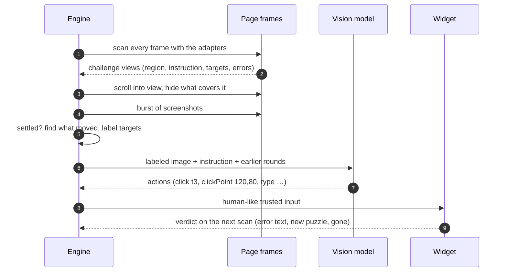
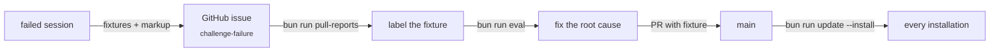

# Architecture

How the solver finds a challenge, decides what to do, acts, and recovers. For a hands-on tour with real challenges, open the [interactive explainer](https://samuelscheit.github.io/llm-captcha/how-it-works.html).

- [Layout](#layout)
- [Drivers](#drivers)
- [One solve round](#one-solve-round)
- [When the model is not asked](#when-the-model-is-not-asked)
- [Recovering by itself](#recovering-by-itself)
- [Improving itself](#improving-itself)

## Layout

```
src/core/       runtime-agnostic: engine (solve loop), adapters, prompt, model call (AI SDK),
                gesture plans, CDP input, image analysis (puzzle, shift, stamps), scoring
src/page/       runs inside page frames (isolated world): scanner, canvas image tools
                (crop, label, motion), measurements, state publishing
src/extension/  MV3 extension: content script (scanner, frame offsets, wake-up),
                ExtensionDriver (chrome.scripting + chrome.debugger), options page
src/cdp/        CdpDriver over any CDP session provider; Playwright and Puppeteer hosts
src/tools/      developer and operations tools (`bun run <name>`)
fixtures/       real challenges by provider, replayed by eval, bench and the e2e suite
test/           unit, e2e (local pages and vendor test widgets, every driver), live (real widgets)
```

## Drivers

The engine talks to a browser only through `Driver` (`src/core/driver.ts`): `scan`, `reveal`, `uncover`, `input` (trusted mouse and keys, screenshots), `images`, the measurements (`puzzle`, `gridShift`, `countStamps`) and `publish`.



- **ExtensionDriver.** Content scripts in every frame scan, and resolve frame offsets by asking their parent frame. `chrome.debugger` is attached only while a challenge is being solved, for trusted input.
- **CdpDriver.** The page bundle (`dist/page.js`) is injected into an isolated world per frame, which page scripts cannot see. Out-of-process frames are found through `iframe` targets. Closed shadow roots (Turnstile) are read with `DOM.getDocument({pierce})` and handed to the scanner.

## One solve round



1. **Scan** every frame for challenges and pick the open popup over its checkbox. A page that has not rendered its widget yet is watched for up to `appearMs` (15 s) before the session ends as `idle`; so is a page the challenge navigated to (Cloudflare's interstitial reloading into the site), which may bring its own.
2. **Reveal.** Scroll it into view. If an element of the page lies on top of it or of one of its frames (a cookie banner with its backdrop, a modal), clicks would land there: the scanner hit-tests the challenge and every frame element above it, and the engine hides the outermost element covering it before acting, or fails with `covered by <element>`.
3. **Capture** a burst of frames (for animated challenges) and find the regions that moved.
4. **Ask.** Label targets on the image and ask the model for actions, with the errors earlier rounds caused.
5. **Act** with human-like CDP gestures: an eased approach, minimum-jerk drags, focus emulation.
6. **Read the verdict** and feed errors into the next round.

Some kinds never reach the model:

| Kind | What happens instead |
|---|---|
| `checkbox` | clicked, spaced so the vendor's verdict can arrive (Turnstile restarts its check on every click); without targets, the engine waits for a check that runs by itself |
| `slider` puzzle | the gap is found by image analysis, then dragged to with a nudge-and-correct track |
| `slider` to the end | dragged past the rail's end on a track that never goes back |
| `hold` | pressed and held with slight movement until the widget is done |
| `stamps` | counted by image analysis (the model only when the picture cannot be learned) |
| `shiftedGrid` | the model points into a clean reference; the roll to the noisy challenge is measured |

A widget that hands a token to its page (reCAPTCHA, hCaptcha, Turnstile) declares that field as `response`: the challenge counts as solved only once the field next to its frame holds a value. A checked box without one is still verifying, and a widget that disappears from a page that stays without one has failed.

## When the model is not asked

The model is asked only about a challenge at rest. These checks cost no round:

- **Loading or animating:** the scanner reports a challenge as `waiting` while an image in it is still loading or a finite CSS animation or transition is running, such as reCAPTCHA's replacement tiles fading in.
- **Still changing on screen:** each round's frames are compared; any change in a non-animated challenge, or a change across most of an animated one, means it has not settled.
- **Moved while the model thought:** the challenge is scanned again just before acting, and the answer is dropped if the challenge moved meanwhile.

Animated challenges (`point` by default, or `animated: true` in the adapter) are captured as 3 frames 300 ms apart. hCaptcha fades its shapes in and out, so a single frame hides some of them. The model gets every frame, with the moving regions outlined and listed.

## Recovering by itself

| Trouble | Response |
|---|---|
| Wrong answer | the widget's error goes back to the model with the earlier rounds |
| Two rejections in a row | the widget's reload button, and a fresh history |
| Unclear image analysis (ambiguous gap, unclear roll) | a new puzzle instead of a guess |
| Failed model call | the next configured fallback model |
| Lost wake-up | a frame that stays pending wakes the service worker again every few seconds |
| Stalled call | every wait, screenshot and model call ends at the session deadline |
| Failed session | the page reads `failed` with a reason; the extension does not retry that tab (no paid loops) until it navigates |

## Improving itself



1. **Failure reports.** With reports configured (options page, or `reportToGitHub` in the library), a failed session pushes its last rounds as fixtures and the challenge frame's markup to a `fixtures/<provider>/<time>` branch. It then files a `challenge-failure` issue showing what the model saw, or comments on the open one with the same title. Page URLs are reported without query or fragment.
2. **Triage.** `bun run pull-reports` restores reported rounds into `fixtures/captured/`. You or an agent label them, reproduce with `bun run eval`, fix the root cause, and open a PR that carries the new fixtures. [AGENTS.md](../AGENTS.md) is the playbook.
3. **Self-update.** `bun run update --install` checks hourly. It accepts only fast-forwards of a clean checkout, builds into a staging directory and swaps it in only when the unit tests pass, so a broken commit never reaches `dist/`. The extension notices the new `build.json` and reloads itself between solves.

> [!WARNING]
> Updates run code from the upstream branch in your browser: point the checkout at a repository you trust.
